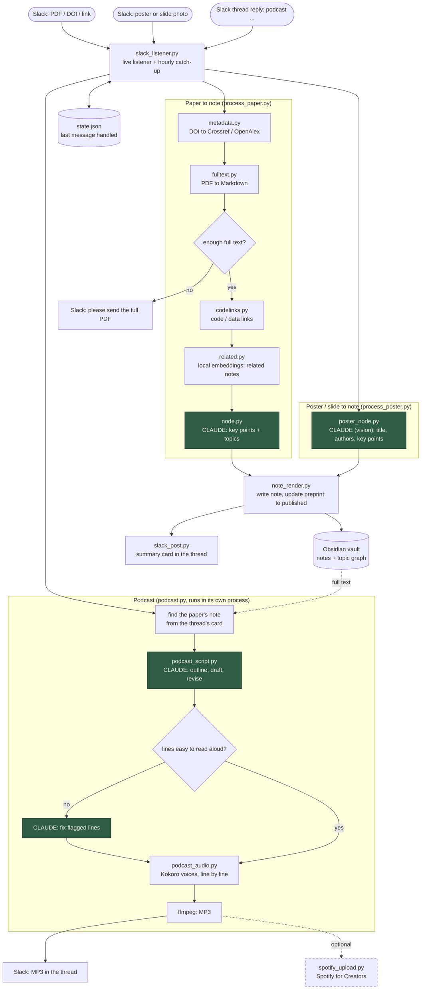

# LitAuto: Literature Automation
### Save, link and query all literature you come across through one Slack message

**Drop a paper in Slack → get a structured, cross-linked Obsidian literature note back.
Reply `podcast` → get a two-host audio episode about it.**

Works on **macOS, Linux and Windows**. Runs on your own computer with your own Slack,
your own [Obsidian](https://obsidian.md) vault and your own [Claude Code](https://docs.claude.com/en/docs/claude-code)
subscription. No coding needed to set it up.

<!--  — add once you record the demo GIF -->

---

## What it does

| You do this in Slack | You get back |
|---|---|
| Drop a **PDF**, paste a **DOI** or a journal **link** | A note in your Obsidian vault: title, authors, key points, your topic tags, links to related papers you've already saved, code/data links, and the full text. A summary card in the Slack thread. |
| Drop a **photo of a poster or talk slide** | The same kind of note, read from the image. |
| Reply **`podcast`** under a paper's card | A ~25-minute, two-host episode about the paper, posted as an MP3 in the thread. |
| Reply **`podcast short`**, **`podcast 15 min critique`**, **`podcast focus on the statistics`** … | The episode shaped your way: length (`short`, `long`, `N min`), format (`critique`, `debate`) and anything you want it to focus on. |

Anything you drop while your computer is off is picked up the next time it starts.
Optionally, episodes can also be published to your own **Spotify for Creators** show
(most people just listen in Slack).

## Quick start

You need: a Slack workspace where you can add apps, [Obsidian](https://obsidian.md)
(make an empty vault), and a Claude subscription.

1. **Install two tools** (once):
   - [uv](https://docs.astral.sh/uv/getting-started/installation/) (runs the pipeline's Python for you)
   - [Claude Code](https://docs.claude.com/en/docs/claude-code), then type `claude` in a terminal once to log in
2. **Download the pipeline:**
   ```bash
   git clone https://github.com/neurogeek03/Literature_auto.git LitAuto
   cd LitAuto
   ```
   (No git? Use the green **Code → Download ZIP** button on GitHub and unzip it.)
3. **Let Claude set it up.** In that folder, type `claude` and say **"set me up"**.
   It walks you through everything: your vault, the Slack app (from the included
   [manifest](slack_manifest.yaml)), your research topics, podcasts, and running in the background.
   Prefer a plain questionnaire? Run `uv run python -m src.setup` instead.
4. **Drop a paper** in your Slack channel. A note appears in Obsidian within a minute or two.
5. **Reply `podcast`** under the paper's card. The episode arrives in about 10 minutes.

## How it works



Green boxes are the only steps that use an AI model (Claude Code, on your own
subscription). Everything else gives the same output for the same input.

**In words:**
1. **Intake.** The listener watches one private Slack channel. If your computer was off,
   it catches up on missed messages at start and every hour, using `state.json` and a
   check-mark reaction so nothing is processed twice.
2. **Paper to note.** Metadata comes from Crossref/OpenAlex; the PDF becomes Markdown.
   If only an abstract or a paywall page came through, it asks you for the full PDF
   instead of writing a thin note. Related notes are found with a small local embedding
   model. Claude writes the key points and picks 1-3 of *your* topics. The note is written
   into your vault and a card is posted in the thread.
3. **Podcast (on request).** Your `podcast` reply starts a separate job. Claude writes the
   script the way NotebookLM does (outline, draft, then a critique-and-revise pass that
   adds natural back-and-forth), a quick check catches anything the voice would stumble on,
   [Kokoro](https://huggingface.co/hexgrad/Kokoro-82M) voices it on your computer, and the
   MP3 is posted in the thread (and optionally published to Spotify). The local copy is
   then deleted.

## Settings

Everything lives in `config.yaml` (created by setup, private to you), grouped from
must-have to optional:

| Group | What | Default |
|---|---|---|
| **Core** | vault folder, Slack channel, your email, your topics | set by setup |
| **Tuning** | full-text threshold, related-note settings, Claude model | sensible defaults |
| **Podcasts** | on/off, length, voices, pauses | on, 25 min |
| **Spotify** | publish episodes to your show | off |

Re-run setup any time to change answers (`claude` → "set me up", or
`uv run python -m src.setup`); add topics with `uv run python scripts/setup_topics.py --add`.

## Troubleshooting

| Symptom | Fix |
|---|---|
| Nothing happens after a drop | `uv run python -m src.service status`; logs are in `.cache/listener.err.log`. |
| Card says the node was skipped / "claude not found" | Type `claude` once in a terminal to log in, then `uv run python -m src.service install` again. |
| "Couldn't post it here" for a podcast | The Slack app needs the `files:write` permission (OAuth & Permissions → reinstall). |
| Spotify upload failed | Run `uv run python -m src.spotify_upload --login` again; the MP3 is still in Slack. |
| Podcast failed | The reason is posted in the thread; details in `.cache/podcast.log`. Reply `podcast` to retry. |
| Linux: stops when you log out | `loginctl enable-linger $USER` |

---

## For developers

### Design

An event-driven agent with a deliberately **small** model surface: the model is fenced
into the few steps that need judgment, everything else is deterministic plumbing.

- **Slack is the durable queue.** Nothing is held in memory; `catchup.py` replays channel
  history since the `state.json` cursor through the same handler the live listener uses,
  and a reaction marker dedups. Thread replies never move the cursor.
- **Hard determinism boundary.** Metadata, full-text extraction, code links, embeddings,
  preprint↔published matching and rendering are pure functions. LLM steps are headless
  Claude Code skills (`claude -p "/<skill>"`) with strict output contracts: `paper-node`,
  `poster-node` (vision, `--allowedTools Read`), and the on-demand `paper-podcast`.
- **Preprint↔published de-duplication.** Detected via Crossref/OpenAlex relations, then a
  tightly gated title + first-author fallback; the note is updated in place, keeping the
  summary and your own notes.
- **Podcasts in their own process**, so a listener restart can't kill a long job. Script
  phases are validated by content (not exit code) and cached in `.cache/podcasts/` so audio
  can be re-voiced with `--reuse-script`.
- **Cross-platform.** One background service per OS (`src/service.py`: launchd, systemd
  user unit, Task Scheduler + `src/supervise.py`); Kokoro runs on MLX on Apple Silicon and
  PyTorch elsewhere; ffmpeg is bundled (`imageio-ffmpeg`); HEIC photos via `pillow-heif`.

### Module map

| Module | Role | Model? |
|--------|------|--------|
| `slack_listener.py` | Socket Mode listener, routing, `podcast` replies, hourly catch-up, watchdog | — |
| `catchup.py` | Replays drops missed while offline through the same handler | — |
| `process_paper.py` / `process_poster.py` | Orchestrate the paper / image paths | — |
| `metadata.py` | DOI → Crossref/OpenAlex → fields + citekey; preprint detection | — |
| `fulltext.py` | PDF → Markdown + sufficiency gate | — |
| `codelinks.py` | Code/data availability links | — |
| `related.py` | fastembed embeddings + cosine; incremental vault index | — |
| `node.py` | Full text → key points + topic tags | **Claude** |
| `poster_node.py` | Image → fields + key points + tags | **Claude (vision)** |
| `note_render.py` | Template → vault note; preprint↔published update | — |
| `conference.py` | Caption → whitelisted conference tag | — |
| `podcast.py` | Podcast job: command parsing, note reading, delivery | — |
| `podcast_script.py` | Outline → draft → revise → fix, with content validation | **Claude** |
| `podcast_audio.py` | Kokoro (MLX or PyTorch) + pauses + ffmpeg MP3 | — |
| `spotify_upload.py` | Playwright upload, Claude-in-Chrome fallback | (fallback only) |
| `slack_post.py` | Every Slack reply, file upload | — |
| `setup.py` / `service.py` / `supervise.py` | Setup wizard; background service per OS | — |
| `drive.py` | Legacy Google Drive staging for NotebookLM (off by default) | — |
| `build_index.py` | Full manual re-embed of the vault | — |
| `config.py` | Loads `config.yaml` + `.env`; finds the Claude CLI | — |

Skills live in `skills/` (copied to `~/.claude/skills/` by setup); the setup assistant
skill is in `.claude/skills/setup-pipeline/`.

### Command line

```bash
uv sync --extra podcast                      # install (add --extra drive for legacy Drive staging)
uv run python -m src.setup                   # setup wizard (re-runnable)
uv run python -m src.service install|uninstall|status
uv run python -m src.slack_listener          # run in the foreground instead
uv run python -m src.process_paper paper.pdf --doi 10.xxxx/yyyy      # no Slack
uv run python -m src.process_poster poster.jpg --prompt "ISMB 26"
uv run python -m src.podcast "<vault>/@Author_Year.md" --focus "the statistics" --no-upload
uv run python -m src.build_index             # full re-embed
uv run python -m unittest discover tests     # tests (CI runs them on macOS, Linux, Windows)
```

## License

MIT. See [LICENSE](LICENSE). Podcast prompt design adapts ideas from Local-NotebookLM,
Open-NotebookLM, NotebookLlama, podcastfy and podcast-creator (see `skills/paper-podcast`).
